# Stage DB-02 — Logical ERD

This engine-neutral ERD reflects the DB-02 logical model. It intentionally excludes physical types, migrations, indexes in engine syntax, backend endpoints, and GenAI implementation. `Conversation` and `Message` are shown as conditional entities.

```mermaid
erDiagram
    USER_ACCOUNT ||--o| STUDENT_PROFILE : owns
    USER_ACCOUNT ||--o{ AUTH_SESSION : has
    USER_ACCOUNT ||--o{ CONSENT_RECORD : controls
    USER_ACCOUNT ||--o{ CONSENT_HISTORY : changes
    USER_ACCOUNT ||--o{ PROFILE_COURSE : enrolls
    COURSE ||--o{ PROFILE_COURSE : contains
    USER_ACCOUNT ||--o{ PROFILE_INTEREST : selects
    SOCIAL_INTEREST ||--o{ PROFILE_INTEREST : catalogs

    USER_ACCOUNT ||--o{ DISCOVERY_ACTION : acts
    USER_ACCOUNT ||--o{ DISCOVERY_ACTION : targets
    USER_ACCOUNT ||--o{ CONNECTION : participant_a
    USER_ACCOUNT ||--o{ CONNECTION : participant_b

    STUDY_LOCATION ||--o{ STUDY_TABLE : contains
    STUDY_TABLE ||--o{ STUDY_SLOT : schedules
    STUDY_LOCATION ||--o{ STUDY_SLOT : scopes
    CONNECTION ||--o{ BOOKING : authorizes
    BOOKING ||--|{ BOOKING_PARTICIPANT : includes
    USER_ACCOUNT ||--o{ BOOKING : creates
    USER_ACCOUNT ||--o{ BOOKING_PARTICIPANT : attends
    STUDY_TABLE ||--o{ BOOKING : reserved_by
    STUDY_SLOT ||--o{ BOOKING : identifies

    USER_ACCOUNT ||--o{ IDEMPOTENCY_RECORD : submits
    BOOKING ||--o{ IDEMPOTENCY_RECORD : reconciles

    USER_ACCOUNT ||--o{ BLOCK : blocks
    USER_ACCOUNT ||--o{ BLOCK : is_blocked
    USER_ACCOUNT ||--o{ MODERATION_REPORT : reports
    USER_ACCOUNT ||--o{ MODERATION_REPORT : reported
    USER_ACCOUNT ||--o{ MODERATION_REPORT : reviews
    USER_ACCOUNT ||--o{ NOTIFICATION : receives
    USER_ACCOUNT ||--o{ AUDIT_EVENT : acts
    USER_ACCOUNT ||--o{ AUDIT_EVENT : is_target
    USER_ACCOUNT ||--o{ OUTBOX_EVENT : triggers

    CONNECTION ||--o{ CONVERSATION : may_enable
    CONVERSATION ||--o{ MESSAGE : contains
    USER_ACCOUNT ||--o{ MESSAGE : sends

    USER_ACCOUNT {
        ID user_id PK
        TEXT role
        TEXT account_status
        TEXT verification_status
        TEXT email_private
        TIMESTAMP created_at
    }
    STUDENT_PROFILE {
        ID user_id PK, FK
        TEXT display_name
        TEXT social_bio
        TEXT study_goals
        INTEGER profile_version
    }
    AUTH_SESSION {
        ID session_id PK
        ID user_id FK
        TIMESTAMP expires_at
        TIMESTAMP revoked_at
    }
    CONSENT_RECORD {
        ID consent_id PK
        ID user_id FK
        TEXT mode
        BOOLEAN has_consent
        TIMESTAMP updated_at
    }
    COURSE {
        ID course_id PK
        TEXT code UK
        TEXT name
    }
    PROFILE_COURSE {
        ID user_id FK
        ID course_id FK
        TIMESTAMP enrolled_at
    }
    SOCIAL_INTEREST {
        ID interest_id PK
        TEXT category
        TEXT name
    }
    PROFILE_INTEREST {
        ID user_id FK
        ID interest_id FK
    }
    DISCOVERY_ACTION {
        ID action_id PK
        ID actor_user_id FK
        ID target_user_id FK
        TEXT mode
        TEXT action_type
        TEXT discovery_round_id
    }
    CONNECTION {
        ID connection_id PK
        ID user_a_id FK
        ID user_b_id FK
        TEXT mode
        TEXT status
        TIMESTAMP updated_at
    }
    STUDY_LOCATION {
        ID location_id PK
        TEXT name
        BOOLEAN active
    }
    STUDY_TABLE {
        ID table_id PK
        ID location_id FK
        INTEGER capacity
        BOOLEAN active
    }
    STUDY_SLOT {
        ID slot_id PK
        ID table_id FK
        DATE local_date
        TIME start_time
        TIME end_time
        TEXT status
    }
    BOOKING {
        ID booking_id PK
        ID connection_id FK
        ID booker_id FK
        ID table_id FK
        ID slot_id FK
        DATE local_date
        TEXT status
        INTEGER booking_version
    }
    BOOKING_PARTICIPANT {
        ID booking_id FK
        ID user_id FK
        TEXT participant_role
    }
    IDEMPOTENCY_RECORD {
        ID idempotency_id PK
        ID actor_user_id FK
        TEXT operation_type
        TEXT client_operation_id
        TEXT outcome_status
    }
    BLOCK {
        ID actor_user_id FK
        ID target_user_id FK
        BOOLEAN active
        TIMESTAMP created_at
    }
    MODERATION_REPORT {
        ID report_id PK
        ID reporter_user_id FK
        ID reported_user_id FK
        TEXT status
        TEXT category
        TIMESTAMP created_at
    }
    NOTIFICATION {
        ID notification_id PK
        ID recipient_user_id FK
        TEXT event_type
        BOOLEAN is_read
        TEXT dedupe_key
    }
    AUDIT_EVENT {
        ID audit_event_id PK
        ID actor_user_id FK
        TEXT target_type
        TEXT target_id
        TEXT outcome
        TEXT correlation_id
        TIMESTAMP occurred_at
    }
    OUTBOX_EVENT {
        ID outbox_event_id PK
        TEXT aggregate_type
        TEXT aggregate_id
        TEXT event_type
        TEXT status
        TEXT dedupe_key
    }
    CONVERSATION {
        ID conversation_id PK
        ID connection_id FK
        TEXT status
    }
    MESSAGE {
        ID message_id PK
        ID conversation_id FK
        ID sender_user_id FK
        TEXT content
        TIMESTAMP sent_at
    }
```

## Booking key and occupancy note

The logical resource key is `(table_id, local_date, slot_id)`. Under the recommended exclusive-table baseline, one active `CONFIRMED` booking occupies the whole two-person table slot. `PENDING_PARTNER_APPROVAL` is non-occupying unless the pending-hold policy is approved; `COMPLETED` and `CANCELLED` do not occupy. A physical implementation must enforce the approved active-status rule with a unique constraint/index and must perform create, reschedule, cancel, audit, and outbox changes within the approved transaction boundary.
