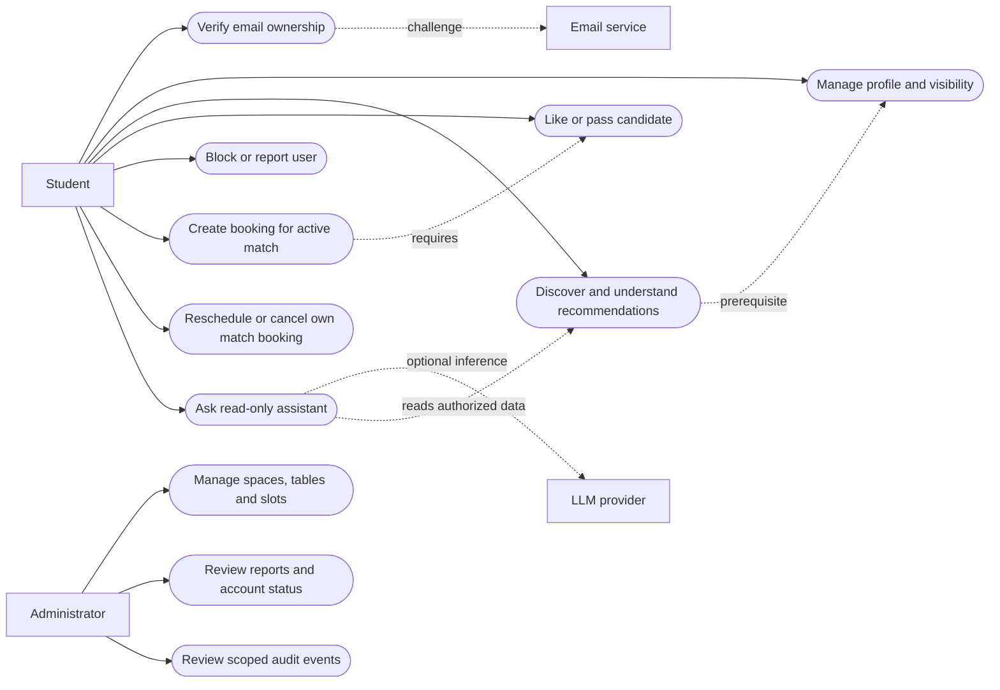

# Campus Duo — Requirements Specification and Use Cases

**Course:** CS455 Software Engineering  
**Deliverable:** 1 — Requirements  
**Status:** Draft for team/instructor review; not evidence of implementation  
**Baseline:** `main_proposal.md`, draft 1.0 (23 September 2026)  
**Owner/reviewers:** TBD / TBD  
**Last updated:** 23 September 2026

## 1. Purpose and scope

Campus Duo is a prototype for IIT Kanpur students to discover study partners, establish mutual study matches, and reserve platform-managed two-person study-table slots. An optional read-only AI assistant helps explain recommendations and find available slots. This is **not** an official IITK facility reservation system. Any real campus inventory requires authorization and accurate availability data.

### Goals

1. Return eligible, explainable, deterministic partner recommendations.
2. Prevent duplicate active bookings of a table/date/slot, including concurrent requests.
3. Restrict the agent to authorized, read-only recommendations and availability lookup.

### Actors

| Actor | Responsibilities |
|---|---|
| Student | Verify email ownership; manage profile and visibility; find, like, block, report and match with students; manage own matched-pair bookings; ask the assistant. |
| Administrator | Manage platform-owned table inventory, reports, account status and scoped audit review. |
| Email verification service | Deliver verification challenge; successful challenge establishes ownership of a permitted institute-domain email, not guaranteed comprehensive affiliation. |
| LLM provider | Optional external inference for the read-only assistant; never authoritative for eligibility, scores, permissions or bookings. |

### Scope boundaries

**In MVP:** verification, profile/consent, discovery and scoring, mutual likes, admin resource lifecycle, booking/reschedule/cancel, reporting/blocking, read-only agent, audit and failure fallback.

**Later, if approved:** real-time chat, social/dating mode with separate consent, Pomodoro and agenda generation. Neither official room-booking integration nor automatic agent writes is in scope.

## 2. Use-case diagram

The arrows marked prerequisite/read are dependencies, not UML `include`/`extend` relations. The agent does not invoke booking or moderation writes.

## 3. User stories and acceptance criteria

| ID | Story | Acceptance criteria |
|---|---|---|
| US-01 | As a student, I want to verify my institute email so that only eligible account holders enter student workflows. | Controlled verification succeeds for allowed domain; unverified requests to protected APIs fail; the UI describes the ownership-only limitation. |
| US-02 | As a student, I want to control my discoverability and profile so that I can participate by consent. | Non-discoverable/blocked candidates are excluded server-side; profile updates change future results. |
| US-03 | As a student, I want scored recommendations with reasons so that I can understand the ranking. | Eligible candidates alone are scored; deterministic fixtures reproduce numerical scores; displayed reasons match permitted features. |
| US-04 | As a student, I want mutual likes before a study match so that contact and booking require two-sided interest. | One like creates no active match; second reciprocal like creates exactly one; repeats do not duplicate it. |
| US-05 | As a matched student, I want to book an available two-person table slot so that our session is reserved without overlap. | Only a member of an active match can book; a simultaneous final-slot race yields exactly one active booking and conflicts for the rest. |
| US-06 | As a matched student, I want to reschedule/cancel our booking so that I can change plans safely. | Target conflict leaves original booking intact; successful cancellation frees slot; repeat cancellation is idempotent. |
| US-07 | As an admin, I want to onboard and disable tables so that inventory is managed safely. | Disabled tables reject new bookings; removal with active future bookings is blocked pending audited resolution. |
| US-08 | As a student, I want to block/report another student so that I can protect myself. | Block prevents bilateral discovery/contact; report is visible only to authorized moderation workflow. |
| US-09 | As a student, I want to ask the agent for partners/slots so that I can search in natural language. | Tool calls are authorized and read-only; LLM outage leaves deterministic search and booking usable. |
| US-10 | As an admin, I want a scoped audit trail so that I can review consequential changes. | Booking and moderation transitions have redacted, attributable audit records. |

### Principal use case: reserve slot (UC-01)

**Actor:** authenticated, active member of an active mutual study match.  
**Preconditions:** verified identity, active match, enabled table and fixed slot; request contains a unique idempotency key.  
**Main flow:** validate membership and slot; atomically claim `(tableId, localDate, slotId)`; commit booking plus audit/outbox event; return confirmed booking to caller.  
**Alternates:** unavailable/competing claim returns `409 Conflict` and safe alternative availability; duplicate same-key retry returns original outcome; unauthorized match/table request is denied; database failure returns no confirmed booking.  
**Postcondition:** at most one active booking owns the slot; no success response precedes durable commit.

### Supporting use cases

- **UC-02 Discover:** authenticate → filter eligibility → compute deterministic scores → return safe cards, approved reasons and data-completeness indicators.
- **UC-03 Mutual match:** submit like → if reciprocal active like exists, create/get one active pair match; prevent blocked users from new interaction.
- **UC-04 Reschedule:** validate membership and booking version → atomically claim target and release source → return new version; on failure retain source.
- **UC-05 Cancel:** authorize member → transition active booking to cancelled and release claim → record audit → repeat yields same final state.
- **UC-06 Admin inventory:** authorize administrator → add/modify/disable table/slots → preserve existing bookings; deny unsafe deletion.
- **UC-07 Agent assistance:** parse request → authorize each read tool → retrieve sanitized results → grounded answer or deterministic fallback; no write actions.

## 4. Functional requirements

All `Must` requirements are planned for MVP; acceptance evidence below specifies what must be demonstrated, not what has already passed.

| ID | Priority | Requirement | Verification |
|---|---|---|---|
| FR-01 | Must | Require ownership verification of an allowed IITK email before student APIs. | Verification and unauthorized access tests. |
| FR-02 | Must | Enforce student/admin role permissions in backend routes and tools. | Student-to-admin denial test. |
| FR-03 | Must | Permit profile editing and study-discovery opt-in/out; exclude hidden or mutually blocked pairs. | Visibility/block tests. |
| FR-04 | Must | Filter and score candidates by the exact deterministic policy below, with allowed reasons. | Hand-calculated, optional-data and tie fixtures. |
| FR-05 | Must | Create one active match only upon reciprocal likes; retries must be idempotent. | One-sided, two-sided and repeat-like tests. |
| FR-06 | Must | Admin can create/update/disable table inventory; disallow removal with future active bookings until resolved. | Lifecycle and authorization tests. |
| FR-07 | Must | Permit no more than one active reservation for a table/date/slot, enforced by storage under concurrency. | Last-slot race and durable record check. |
| FR-08 | Must | Reschedule atomically and reject stale booking versions; failed target claim preserves original. | Conflict, stale-write and failure tests. |
| FR-09 | Must | Cancel atomically, release claim and make repeated cancellation safe. | Rebooking and retry tests. |
| FR-10 | Must | Expose only allow-listed, backend-authorized read tools to the agent; forbid agent writes. | Prompt-injection and tool-policy tests. |
| FR-11 | Must | Keep deterministic discovery and bookings available when inference fails. | Simulated provider outage. |
| FR-12 | Must | Record consequential state transitions with redacted audit metadata and correlation ID. | Audit inspection and leakage checks. |
| FR-13 | Must | Allow student blocking/reporting and authorized admin review. | Role and workflow tests. |
| FR-14 | Should | Allow mutual-match messaging only with per-message authorization, if time permits. | Unmatched send/read denial tests. |
| FR-15 | Could | Add independently opted-in social mode only after separate review. | Approved new policy and tests; not part of MVP. |

## 5. Matching and booking rules

### Candidate eligibility

Server filters out the requester; unverified/inactive/non-discoverable accounts; either-direction blocks; requester-hidden or requester-reported candidates; and candidates without shared declared weekly time slots. Required profile fields: at least one canonical course/topic ID and one weekly availability slot. Reports alone do not cause a global penalty without moderation review.

### Scoring contract

For an eligible pair, components in `[0,1]`: `C` = course/topic Jaccard overlap; `T` = weekly-slot overlap divided by the smaller availability-set size; `P` = mean normalized study-style agreement across jointly supplied fields; `L` = same area 1, predefined nearby area 0.5, otherwise 0; `G` = goal Jaccard overlap. Base weights: `C=.35, T=.25, P=.20, L=.10, G=.10`.

`score = 100 × Σ(weight_i × factor_i for available i) / Σ(weight_i for available i)`.

`C` and `T` are always available. For optional `P`, `L`, `G`, include only when both supplied that field. Sort by unrounded score; near ties within one point favor more absolute shared slots; exact ties use deterministic daily rotation seeded by candidate IDs/date. Round only for display and flag limited optional preference data. Specify the style-field scoring map and area adjacency table before coding; until approved, `P` and nearby `L` behavior remain open decisions.

### Booking rules

A bookable resource is one two-person table for one fixed, non-overlapping slot on a local date in `Asia/Kolkata`. Only an active mutual match may hold it. One member may create/cancel for the pair in the proposed MVP, with notification to both; **confirm this policy with the team**. Unique active claim is keyed by `(tableId, localDate, slotId)`; do not rely on a read-before-write check. Failed reschedule keeps original. Idempotency key is scoped by caller and operation. Audit and notification scheduling follow commit. Slot duration, advance window, cancellation window, and member-block policy for future bookings are pending decisions.

## 6. Non-functional requirements

| ID | Priority | Proposed measurable criterion | How to assess |
|---|---|---|---|
| NFR-01 | Must | Zero duplicate active claims in reproducible concurrent race across distinct matched pairs. | Concurrent integration test plus DB count. |
| NFR-02 | Must | Authentication, route/tool RBAC, input validation and secret-free logs; deny access to another pair's booking. | Automated security and authorization tests. |
| NFR-03 | Must | No private email, exact private calendar, hidden profile or credentials in discovery/agent outputs and logs. | Seeded privacy leak tests and log review. |
| NFR-04 | Must | Ranking and booking remain operational during LLM timeout/outage; failed write does not report success. | Fault-injection tests. |
| NFR-05 | Target | At least 80% code coverage unless an approved exception is documented. | CI coverage report by relevant module; target, not current result. |
| NFR-06 | Target | Capacity baseline: 100 daily active users and 250 core transactions/day or documented equivalent. | Defined mixed-workload load test; no performance claim yet. |
| NFR-07 | TBD | Set p95 latency and throughput budgets with environment, dataset and concurrency before load testing. | Approved test plan and measured report. |
| NFR-08 | Must | Auditable state transitions with minimal redacted metadata and correlation identifiers. | Audit continuity tests. |
| NFR-09 | Must | Consistent slot timezone and fixed slot identity throughout UI/API/database. | Cross-date/timezone boundary tests. |
| NFR-10 | Target | Accessibility and usability checks for core student/admin flows; choose measurable standard before implementation. | Manual/automated checks against agreed criterion. |

<!-- ## 7. Open decisions and sign-off

- [ ] Confirm instructor approval of the proposal and final MVP scope.
- [ ] Confirm allowed email domain/verification mechanism and account deletion/retention policy.
- [ ] Confirm slot duration, booking horizon, local-date semantics and conflict policy for a pair's simultaneous bookings.
- [ ] Confirm whether one or both matched students approve booking; clarify block/report effects on existing matches/bookings.
- [ ] Approve exact scoring maps for optional style and area; choose latency/accessibility budgets.
- [ ] Team reviews requirement IDs, priorities and acceptance criteria; record approval/date here.

**Approved by/date:** TBD. Changes require requirement-ID updates and corresponding traceability/test updates. -->
