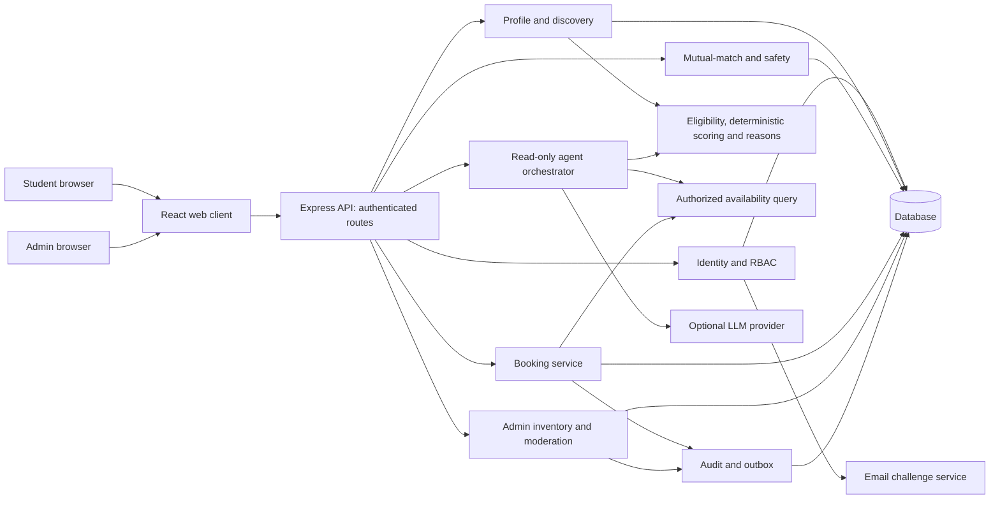

# Campus Duo — Architecture and Design

**Course:** CS455 | **Deliverable:** 1 | **Status:** Proposed, not implemented  
**Baseline:** `main_proposal.md` and `01-requirements-and-use-cases.md`  
**Owner/reviewers/date:** TBD / TBD / 23 September 2026

## 1. Context and constraints

Campus Duo is a course prototype, not an official IITK booking service. The design prioritizes explainable matching, server-side permissions and a database-enforced single-claim rule for two-person table slots. A React client, Node.js/Express modular monolith, MongoDB and optional external LLM are the initial proposal; database choice and deployment support remain to be validated before implementation. `Asia/Kolkata` is the proposed slot timezone.

## 2. System and component diagrams



Trust boundaries: browser input is untrusted; backend enforces authentication, authorization and input validation on every route and agent tool. LLM input/output is also untrusted and cannot choose authoritative scores or mutate data. Database writes for booking state and audit/outbox events must use supported transactional guarantees; do not mark a transaction successful before commit.

### Module responsibilities

| Module | Owns | Forbidden shortcut |
|---|---|---|
| Auth/profile | Identity proof, roles, discoverability, profile versions. | Treat email-domain match alone as comprehensive campus verification. |
| Discovery/scoring | Eligibility, deterministic score, privacy-safe reason codes. | Let the LLM invent score or expose exact private schedules. |
| Match/safety | Reciprocal likes, block/report, match state. | Permit one-sided consent to unlock bookings. |
| Booking | Active claim, versioned reschedule, cancellation, idempotency. | Find-then-insert without a storage constraint. |
| Admin/inventory | Resource activation, safe retirement, report/account decisions. | Delete tables with future active reservations silently. |
| Agent | Intent parsing and bounded read-only tool calls. | Give the agent write credentials/endpoints. |
| Audit/outbox | Redacted transition records and after-commit dispatch. | Deliver notification as if committed when DB operation failed. |

## 3. Core data model

| Entity | Proposed fields/constraints |
|---|---|
| User | `id`, email identity/hash, verification state, role, status, timestamps. Email handling/retention to be settled. |
| StudyProfile | `userId`, public display fields, canonical course IDs, weekly slot IDs, optional preferences, visibility, `version`. |
| Interaction | `actorId`, `targetId`, type (`LIKE`, `PASS`, `HIDE`, `BLOCK`, `REPORT`), timestamp; unique identity/transition policy. |
| Match | Canonically ordered user pair, status, timestamps; prevent duplicate active pair. |
| StudySpace/Table/Slot | Space ID, table ID, two-person capacity, active flag; fixed non-overlapping slot schedule and local-date rules. |
| Booking | `id`, `matchId`, `tableId`, `localDate`, `slotId`, status, version, idempotency reference, timestamps; unique active table/date/slot claim. |
| IdempotencyRecord | Scoped caller, operation and key, request fingerprint, stored response/outcome; retention TBD. |
| Audit/Outbox | Actor, action, target, correlation ID, redacted metadata, event time, delivery status as appropriate. |

Proposed MongoDB approach: unique partial index on `(tableId, localDate, slotId)` with filter for `status: CONFIRMED`; verify index behavior on the actual deployment. Booking state change + audit/outbox writes and rescheduling must execute in supported transactions (typically replica-set capable deployment). On duplicate-key or write conflict, respond with a safe conflict outcome; retry only with bounded, idempotent logic. Confirm that table disablement and booking creation cannot race to produce an unauthorized reservation; validate active inventory inside the appropriate transaction or use an equally strong versioned guard. Avoid using a bare partial index as a substitute for multi-document atomicity. Database decision is open pending feasibility spike.

## 4. Booking sequences

### Concurrent creation

```mermaid
sequenceDiagram
    actor A as Matched student A
    actor B as Other matched pair B
    participant API as Booking API
    participant DB as Transactional DB
    A->>API: POST booking + idempotency key
    B->>API: POST same table/date/slot + different key
    API->>DB: Authorize and attempt active claim for A
    API->>DB: Authorize and attempt active claim for B
    DB-->>API: One commit succeeds; other unique conflict
    API-->>A: 201 confirmed (if winner)
    API-->>B: 409 conflict + safe alternatives (if loser)
    Note over DB: At most one durable active claim
```

Winner is nondeterministic; the response labels above illustrate one possible ordering. A repeated same-key request must return its original result rather than create a second booking.

### Reschedule and cancellation

```mermaid
sequenceDiagram
    actor Student
    participant API as Booking API
    participant DB as Transactional DB
    participant Outbox as Notification worker
    Student->>API: PATCH booking target + expected version
    API->>DB: Begin; validate match, source/version, target and table status
    API->>DB: Atomically move active claim, update version, add audit/outbox
    alt target free and commit succeeds
        DB-->>API: Committed updated booking
        API-->>Student: 200 new slot/version
        DB-->>Outbox: After-commit event available
    else conflict/stale version/failure
        DB-->>API: Abort/no mutation
        API-->>Student: 409 or appropriate error; source intact
    end
    Student->>API: DELETE booking (semantic cancel)
    API->>DB: Authorize; transactionally mark CANCELLED, release claim, audit
    DB-->>API: Committed result or existing cancelled result
    API-->>Student: Cancelled/idempotent outcome
```

`DELETE` is only a proposed API form. The final API contract and precise status codes should be fixed before implementation. Cancellation or block policy must not silently change another user's booking.

### Read-only agent

```mermaid
sequenceDiagram
    actor Student
    participant API as Authenticated API
    participant Agent as Agent orchestrator
    participant Tools as Authorized read tools
    participant LLM as External LLM
    Student->>API: Natural-language search/availability question
    API->>Agent: Caller context from server session + bounded query
    Agent->>LLM: Sanitized task with tool allow-list
    LLM-->>Agent: Proposed read calls / response draft
    Agent->>Tools: Validate arguments, scope, limits, caller authorization
    Tools-->>Agent: Eligible cards, computed scores, reasons, allowed slots
    Agent->>Agent: Validate grounding and redact output
    Agent-->>API: Grounded response or deterministic fallback
    API-->>Student: Recommendations/slots; no write performed
```

Allow-listed calls: `searchEligibleProfiles(filters, limit)`, `calculateCompatibility(candidateIds)`, `getAllowedMatchReasons(candidateIds)`, `getAvailableStudySlots(matchId, dateRange)`. Caller identity must come from the authenticated session, not LLM arguments. Set per-request call/token/time caps; test blocked profiles, injection, invented reasons and provider outage.

## 5. Interfaces and invariants

Proposed routes: `POST /auth/verify`, `GET/PUT /profiles/me`, `POST /recommendations/search`, `POST /matches/likes`, `POST /bookings`, `PATCH /bookings/:id`, `DELETE /bookings/:id`, `GET /tables/availability`, `POST /reports`, `POST/PATCH /admin/tables`. These are design sketches, not implemented endpoints. On cookie sessions apply CSRF protection; validate payloads and apply rate limits to sensitive operations.

**Invariants:** (I1) for each `(tableId, localDate, slotId)`, active booking count ≤ 1; (I2) a booking belongs to an active mutual match at creation; (I3) reschedule either commits both release/claim or neither; (I4) stale version cannot overwrite newer booking state; (I5) agent has no mutation capability; (I6) recommendation fields are limited to authorized public projections.

## 6. Design-pattern mapping

| Pattern | Concrete proposed use | Why / guardrail |
|---|---|---|
| Modular monolith | Separate Express domain modules and interfaces inside one deployable backend. | Clear ownership without distributed transaction complexity. |
| Repository | Booking/match persistence interfaces hide storage details from services. | Enables isolated tests; database constraints remain real integration-test targets. |
| Strategy | Explicit scoring policy implementing fixed weighted factors; future policy version optional. | Reproducible ranking; avoid claiming live personalization exists. |
| Adapter | LLM provider and email verification behind narrow interfaces. | Outage fallback and provider swaps without trusting provider output. |
| Transactional outbox | Stage notification/audit dispatch event with state change when DB supports transaction. | Prevent pre-commit sends; delivery worker remains to be built/tested. |
| Policy/authorization gate | Server checks caller and resource ownership at each API/tool entry. | Central rules plus resource-level checks, never UI-only permissions. |

These are proposed mappings; do not claim deployed patterns until code and tests confirm them.

## 7. Alternatives and decision records

### ADR-001: Modular monolith vs microservices

**Status:** Proposed, team approval pending. **Choice:** modular monolith. **Rejected alternative:** separate booking/matching/agent services. **Reason:** smaller course team and simpler cross-module transaction/authorization boundaries; microservices add deployment, network and consistency overhead without an identified scale need. **Trade-off:** stricter internal module discipline required; revisit if scaling or team independence justifies separation.

### ADR-002: Fixed slots vs arbitrary intervals

**Status:** Proposed. **Choice:** fixed non-overlapping two-person table slots. **Rejected alternative:** arbitrary start/end ranges on rooms or seats. **Reason:** a unique active claim directly represents occupancy; arbitrary overlaps need interval/exclusion semantics and more intricate capacity logic. **Trade-off:** less scheduling flexibility; slot duration and timezone rules must be fixed before build.

### ADR-003: Deterministic score vs LLM ranking

**Status:** Proposed. **Choice:** server-owned eligibility and weighted deterministic score. **Rejected alternative:** LLM-generated eligibility and score. **Reason:** fixtures can verify fairness/consistency and reason faithfulness; prompt output cannot override access rules. **Trade-off:** less semantic nuance; optional LLM may phrase, not decide, results.

### ADR-004: MongoDB vs PostgreSQL for booking

**Status:** Open; do not present as final. **Proposed starting point:** MongoDB, conditional on deployed support for unique partial index and transactions covering claim moves, audit/outbox and inventory guard. **Alternative:** PostgreSQL unique partial index and SQL transactions for the same invariant. **Decision criteria:** demonstrable race safety, transaction/hosting availability, cost, developer familiarity, migration complexity. **Validation spike:** concurrent last-slot requests, target-conflict reschedule, concurrent cancel, duplicate retry, server interruption and disabled-table race on intended hosting. **Decision owner/date/evidence:** TBD.

## 8. Security, reliability and observability

Server-side student/admin RBAC; resource authorization for each match, booking and agent tool; minimal public profile projections; no sensitive traits in scoring; rate-limit verification and risky endpoints; manage secrets outside repository; log only pseudonymous identifiers, action, result and correlation ID. Test prompt-injected profile text and malformed LLM replies. A non-LLM search and templated reasons are fallback. Audit retention, deletion, monitoring, actual cloud provider and costs require team decisions.

## 9. Pre-implementation approval gate

- [ ] Review requirements and booking policy with team/instructor.
- [ ] Confirm actual deployment DB supports required index and transactions; record ADR-004 decision.
- [ ] Fix slot duration, booking horizon, timezone boundary and inventory disablement race policy.
- [ ] Finalize scoring maps and public/private fields.
- [ ] Verify actor/API permissions, agent read-tool schemas and failure behavior.
- [ ] Set API/latency/security test criteria; obtain reviewer sign-off.

**Decision/reviewer/date:** TBD.
